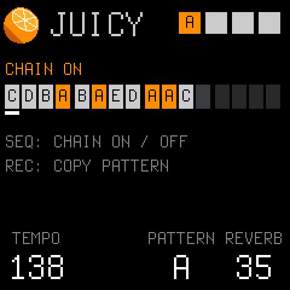
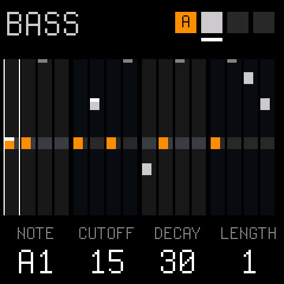

# Juicy

**A groovebox firmware for the M-VAVE FM-1: five tracks, patterns, a chain, and sounds you can shape, made for
jamming.**

Juicy turns the FM-1 into a small step sequencer in the spirit of Fruity Loops: drums, bass, an arpeggiator
that follows the pad's chords, a pad and a lead, each with its own steps, all on the panel without menus. It aims at techno, trance and lo-fi,
and at being easy to pick up: turn it on, press PLAY, and the demo song plays; press a key and you hear the track on
the screen.

<p align="center">
  
  
  
  
</p>

> **Status: early, and changing.** Juicy runs on the FM-1 (tested on the device since 11.11.2026). An update that
> changes how songs are stored starts over with the demo song: until there is a 1.0, don't keep anything in it that
> you can't lose. Juicy builds for the M-Vave SMK-37 too (the platform supports it) but has not been tried there.

## What it does

- **Five tracks:** DRUMS (kick, hat, clap, open hat, snare, tom), BASS, ARP (an arpeggiator over the pad's chords), PAD
  (chords) and LEAD.
- **Patterns A to H.** Each track has 1 to 4 bars of 16 steps of its own; a pattern lasts as long as its longest
  track, the shorter ones repeat. A one-bar beat under a four-bar bass line is just that.
- **A chain** of 16 places plays patterns one after the other, or the pattern on the screen loops.
- **Sounds:** every melodic track has named sounds (BASS: PLUCK, SUB, ACID, REESE; ARP: PLUCK, SQUARE, SAW,
  SOFT; PAD: WARM, BRIGHT, SLOW; LEAD: SUPERSAW, SQUARE, SOFT), a page of knobs to shape them, and two places of
  your own (USER1, USER2) that every song can use.
- **A mixer:** each track's level (each drum's), pan, and how much goes into the tempo-synced echo and the reverb;
  a limiter keeps the sum clean.
- **Mutes** for jamming: drop a track out and bring it back while the song plays.
- **Three demo songs** (acid techno, uplifting trance, lo-fi), **8 songs** of your own, **a library of 16 patterns,**
  and the song you work on saves itself.
- **The keys light up** where they do something, so you can see what the panel does on each screen.

## Install

Juicy installs over USB like every FM-1 firmware: the package is `juicy-<version>.fwsc` from a release, or
`build/juicy.fwsc` built yourself (below). With Python 3 and `pip install mido python-rtmidi`:

```sh
python tools/fm1_install.py --info                   # what runs on the connected FM-1
python tools/fm1_install.py build/juicy.fwsc         # asks before it writes, then restarts into Juicy
```

Back to another firmware, or to the official one, with the [FM-1 Firmware Hub](https://thefirmwarehub.com) in Chrome
or Edge. If the FM-1 ever doesn't start, hold **OCT-** while switching it on: that is the USB rescue, from where any
firmware installs again. Installing firmware is at your own risk.

## Your first jam

1. Switch on. The **JUICY** screen shows the demo song's chain. Press **PLAY**: the song plays, PLAY flashes on the
   beat. PLAY again stops it.
2. Press **SEL**, then **OP2** (the second black key from the left): the BASS screen. Press **SEL** again: now the
   keys play the bass. Nothing you play is recorded.
3. Play a note you like, then press **EDIT** (the title turns orange): the 16 lower keys are the 16 steps of the bar
   on the screen. A key puts the note you played last on that step, or takes it away.
4. **OCT+** goes to the next bar. On the last bar, with EDIT on, it adds a bar.
5. **FX** opens the bass's sound page. Turn **ALGORITHM** for another sound, the four knobs to shape it. **FX**
   again: its mix (level, pan, reverb, echo).
6. **SEL**, then the black key one octave above OP1, mutes the drums. Again: they're back.

## The panel

The keys do one of three things, and two buttons switch between them:

| | How | The keys |
| --- | --- | --- |
| **Play** | SEL and EDIT dark | play the track on the screen. DRUMS: the six lower keys from the left are the six drums. BASS, ARP, LEAD: all 27 keys are notes. PAD: a key plays the chord on that note. What you play last is what EDIT places. |
| **Select** | SEL lit | **OP1 to OP5** pick DRUMS, BASS, ARP, PAD, LEAD. The five black keys an octave above them **mute** those tracks (lit: it plays). |
| **Edit** | EDIT lit, the title orange | the 16 lower keys are the 16 steps of the bar on the screen (on JUICY: the 16 places of the chain). On DRUMS and a track a step key acts when you let go; **held** a moment, it accents the step (see **Accents** below). |

SEL and EDIT are never on together: the one you press switches the other off. **Nothing in the song changes
without EDIT**: the knobs, SEQ and REC wait for it. Only PLAY, moving around and playing the keys work without it.

| Button / knob | What it does |
| --- | --- |
| **PLAY** | start and stop (any time). On SONGS and LIBRARY: **listen** to the selected place (see below) |
| **HOME** | the JUICY screen, and back to the track |
| **SAVE** | the SONGS screen, again the LIBRARY, again back |
| **FX** | a track's pages in turn: its notes, its sound (not DRUMS), its mix. On JUICY: the **NAMES** screen and back |
| **OCT- / OCT+** | the bar before / the next bar. With EDIT on a track: OCT+ past the last bar adds one (up to 4), **holding OCT-** removes the bar on the screen from that track. While recording: the keys an octave down / up (lit: they are) |
| **PRESETS** (knob) | the pattern on the screen, A to H, on every screen |
| **SEQ** | with EDIT: the chain on or off (lit: the chain plays; dark: the pattern on the screen loops) |
| **REC** | on JUICY with EDIT: copies the pattern on the screen into the first empty one. On BASS, ARP, PAD, LEAD with EDIT: **step recording** on or off (REC lit, see below). **Holding REC** with EDIT clears: on JUICY the whole pattern on the screen, on DRUMS the selected drum (the orange row), on BASS, ARP, PAD, LEAD that track, in the pattern on the screen. The bars stay |
| **ALGORITHM** (knob) | on a sound page with EDIT: the next or previous sound |
| **SELECT** (knob) | on DRUMS: the drum the keys edit (the orange row), also on its mix page. On BASS, ARP, PAD, LEAD: the **cursor**, a step framed in the roll, on through the track's bars (EDIT or not; with EDIT its key blinks). Stopped, the note it comes to sounds (not on ARP) |
| **MASTER** (knob) | the volume of the FM-1 itself. Over USB the FM-1 is also a sound card that a computer or phone records from, always at full level: turn MASTER down to record with a silent FM-1 |

### The screens

| Screen | KNOB1 | KNOB2 | KNOB3 | KNOB4 | Also |
| --- | --- | --- | --- | --- | --- |
| **JUICY** | TEMPO | REVERB | SWING of the pattern on the screen: 50 (straight) to 80, every second step later | | the chain: with EDIT a lower key puts the pattern on the screen in that place, or takes it out. The song's name at the right |
| **NAMES** (FX on JUICY) | LETTER: the character at the cursor (with EDIT): A to Z, 0 to 9, -, space | | | | the song's name and the name of the pattern on the screen, 8 characters each. **SELECT** or a lower key moves the cursor: keys 1 to 8 the song's name, 9 to 16 the pattern's |
| **DRUMS** | | | | | **SELECT** (knob) picks the drum the keys edit, the orange row (EDIT or not); three drums at a time, the marks at the bottom say which page |
| **BASS, LEAD** | NOTE | CUTOFF | DECAY | LENGTH: how long a note is: 10 % to 90 % of a step, or 1 to 16 steps (to the bar's end at most) | a piano roll of the bar on the screen; a long note is one bar in it. See **Notes** below |
| **ARP** | MODE of the pattern on the screen: UP, DOWN, UP/DN or RAND, over 1 to 3 octaves | CUTOFF | DECAY | LENGTH, as on BASS | hits, not notes: they play the pad's chord. See **ARP** below |
| **PAD** | NOTE (the chord's root) | CUTOFF | CHORD: MIN, MAJ, MIN7, MAJ7, DOM7, SUS2, SUS4, DIM, POWER (root and fifth), ROOT (the root alone) | | a chord sounds until the next one. See **Notes** below |
| **Sound page** (FX) | WAVE | RESO | ATTACK | ENV | the pad's: SPREAD, RESO, ATTACK, RELEASE. A `*` after the name: changed. With EDIT, **SEQ** keeps the sound as USER1, **REC** as USER2 (each asks twice). The keys always play here |
| **Mix page** (FX) | LEVEL (DRUMS: the selected drum's, the orange row) | PAN | REVERB | ECHO | bars for each; on DRUMS one per drum. The keys always play here (on DRUMS: a key or SELECT picks the drum) |
| **SONGS** (SAVE) | DEMO1 to DEMO3, NEW (empty), 1 to 8 | | | | **SEQ** loads (asks twice), **REC** saves your song there (twice over a song), **PLAY** lets you listen first. No EDIT needed; loading and saving only while stopped. A kept song shows its name |
| **LIBRARY** (SAVE twice) | place 1 to 16 (or a lower key) | | | | **SEQ** puts that pattern into the pattern on the screen (twice if that holds something; works while playing), **REC** stores the pattern on the screen there (while stopped), **PLAY** lets you listen first. A library pattern is its notes, hits, swing and name; it plays with the song's sounds |

### Notes

On BASS, ARP, PAD and LEAD, with EDIT on:

- **A step key** on an empty step puts the next note there (what you played last, or what NOTE and LENGTH show), you
  hear it, and the cursor goes there. On a step with a note, or anywhere on a long note, it takes the whole note away.
- **The knobs work on the note under the cursor:** NOTE changes its pitch (you hear it), LENGTH its length, CHORD
  (PAD) its kind of chord. On an empty step they set the next note instead.
- **Step recording** (a tap of REC, it lights up): the keys play, and each key puts its note at the cursor with the
  LENGTH shown, then the cursor moves on by that length (on PAD: a bar), round the track's bars. Turn SELECT for a
  rest. OCT- / OCT+ move the keys an octave (they stay there when recording ends). REC again or EDIT off ends it.

### Listening before you load

On **SONGS** and **LIBRARY**, PLAY plays the selected place instead of your song: a song as it is (its tempo, its
sounds, its chain), a library pattern in the place of the pattern on the screen, round and round, with your song's
sounds. Turn to another place and that one plays. PLAY again, another screen, PRESETS, SEQ or REC end it, and your
song is exactly as it was.

### Accents

An accented step is louder; on BASS, ARP and LEAD its note is also brighter (the filter opens further), the way an
acid bass bites. With EDIT on, **hold a step key** for a moment (0.6 s) instead of tapping it:

- **DRUMS:** the step's accent goes on or off, for every drum on that step (one accent row, as on classic drum
  machines). On a step without the selected drum, the drum goes there, accented.
- **BASS, ARP, LEAD:** the note on that step (or the long note over it) is accented or not any more. On an empty step
  the next note goes there, accented. PAD has no accents (holding works as a tap).
- Accented hits and notes have a **white top** on the screen. Each pattern keeps its own; clearing a track (holding
  REC) clears its accents, clearing on JUICY all of them.

### ARP

ARP is an arpeggiator: it plays the chord the PAD sounds, one note at a time.

- **Its steps are hits, not notes.** A step key puts a hit there or takes it away; like a drum hit, it is silent
  when placed. LENGTH works as on BASS. Recording, any key puts a hit at the cursor.
- **Each hit plays the next note of the chord** (its one to four notes from the root, from C3 up) in the order **MODE** (KNOB1) says:
  UP, DOWN, UP/DN (up and back down), RAND, over 1, 2 or 3 octaves. Each pattern has its own MODE.
- **A chord on the PAD starts it over** from its first note. Hold a chord on the PAD's keys while the song plays,
  and ARP follows that one until you let go.
- **No chord, no arpeggio:** while the PAD has no chord (an empty pad track, a pattern without one), ARP is silent.
  A muted PAD still leads it: mute the PAD to hear the arpeggio alone.
- The keys on ARP's screen play notes in its sound, to try it out.

### The lights

A key or button that does something on this screen **glows** dimly; one that is on, selected or holds something
(a set step, a used chain place) is **lit**. With EDIT on a track, the steps 1, 5, 9 and 13 glow brighter: the beats.
PLAY flashes on every beat while the song plays. On the JUICY screen, with SEL and EDIT off, the keys follow the
song while it plays: the lower key of the step that sounds is lit, and OP1 to OP4 show the bars of the playing
pattern (glowing), the one that sounds lit. A muted track's name is dark on its screen.

## MIDI and USB

- **Following a clock:** when MIDI clock comes in (USB or the TRS jack), Juicy follows its tempo; the JUICY screen
  shows **EXT** and the tempo it measures. START plays from the top, CONTINUE plays on from where Juicy stopped,
  STOP stops. Juicy starts on the first clock after START or CONTINUE.
- **Leading:** without an incoming clock, PLAY sends START and STOP over USB, and Juicy sends the clock while it plays,
  so a DAW can follow it.
- **Recording:** over USB the FM-1 is a sound card (a line input to the computer), always at full level.

## What is kept

- **The song you work on** saves itself two seconds after the last change, once it is stopped and silent (writing
  the flash would interrupt the sound). It is there again after switching off.
- **SONGS:** eight places for whole songs (patterns, chain, sounds, tempo).
- **LIBRARY:** 16 patterns, apart from the songs.
- **USER1, USER2:** your own sounds, two per melodic track, for every song.

## Build it

Juicy is [firmware/src/juicy.c](firmware/src/juicy.c) (the panel, the pages, saving) with `song.c` (what a song holds),
`demos.c`, `sequencer.c` (the sequencer and the mixer, in the audio interrupt) and `screen.c`, its sound in `drums.c`,
`synth.c`, `pad.c`, `echo.c`, `reverb.c` and `limiter.c`, on Dinghy's platform. They build as one: `juicy.c` includes the rest. The build runs in Docker (on Linux natively, as Dinghy
describes it):

```sh
docker build --platform linux/amd64 -t juicy-build -f tools/Dockerfile tools   # once
docker run --rm -v "${PWD}:/work" juicy-build sh build.sh                     # -> build/juicy.fwsc
docker run --rm -v "${PWD}:/work" juicy-build sh tests/run_tests.sh           # everything; "ALL TESTS PASSED"
docker run --rm -v "${PWD}:/work" juicy-build sh tests/run_host.sh tests/scripts/drums.txt   # on your computer
```

On Windows, `.\build_install.ps1` does it all in PowerShell: it starts Docker Desktop if needed, builds, and installs
on the connected FM-1 (it asks before it writes). The first run also builds the Docker image and a Python venv
(`.venv`) with mido and python-rtmidi.

`tests/run_host.sh` runs Juicy on your computer from a script of key presses and knob turns
([tests/scripts/](tests/scripts/)): the sound as `build/host/juicy.wav`, the screen as PNGs. A browser version with a
clickable FM-1: `sh web/build.sh` in the container, then `node web/serve.js` and <http://localhost:8137>.

**Versions:** the number is in [VERSION](VERSION), and a plain build shows it on the start screen as `0.1-dev`
(identity `FM-1_940`). A release is a tag `v0.1`: GitHub builds `juicy-0.1.fwsc` (identity `FM-1_941`, the start
screen `0.1`). Then `VERSION` moves on to the next number. What changed is in [CHANGELOG.md](CHANGELOG.md).

The chip has no floating point and no 64-bit division; [docs/RULES.md](docs/RULES.md) has its rules,
[docs/API.md](docs/API.md) what the platform offers.

## License and credits

GPL-3.0-only: you may change and share it, and whoever gets a firmware built from it gets its source. Details and
third-party parts in [LICENSING.md](LICENSING.md).

Juicy (the groovebox in `firmware/src/juicy.c` and its sound) by Daniel Gilbert. It is built on
Dinghy by zvenson, whose platform is
[Felucca](https://github.com/hugelton/Felucca) by Leo Kuroshita (@kurogedelic), Hügelton Instruments, with
[SLOOP](https://github.com/isod89/sloop-fm1)'s changes (isod89); the SMK-37 layer by M. Geisler (genkigenki); the
loader's screen after [Skiff](https://github.com/illuminus5/skiff) (illuminus5).

"M-VAVE", "FM-1" and "SMK-37" belong to their owners; Juicy is not made or endorsed by them.
