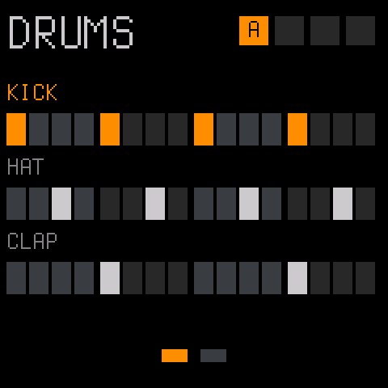
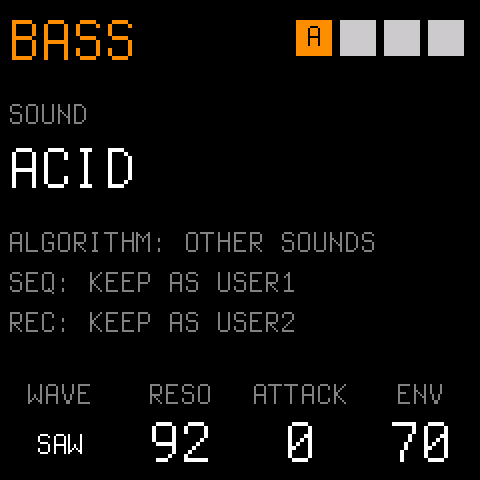

# Juicy

**A groovebox firmware for the M-VAVE FM-1: five tracks, patterns, a chain, and sounds you can shape, made for
jamming.**

Juicy turns the FM-1 into a small step sequencer in the spirit of Fruity Loops: drums, bass, an arpeggio-style
sequence, a pad and a lead, each with its own steps, all on the panel without menus. It aims at trance and ambient,
and at being easy to pick up: turn it on, press PLAY, and the demo song plays; press a key and you hear the track on
the screen.

<p align="center">
  
  
  
  
</p>

> **Status: early, and changing.** Juicy runs on the FM-1 (tested on the device since 11.11.2026). An update that
> changes how songs are stored starts over with the demo song: until there is a 1.0, don't keep anything in it that
> you can't lose. Juicy builds for the M-Vave SMK-37 too (the platform supports it) but has not been tried there.

## What it does

- **Five tracks:** DRUMS (kick, hat, clap, open hat, snare, tom), BASS, SEQUENCE, PAD (chords) and LEAD.
- **Patterns A to H.** Each track has 1 to 4 bars of 16 steps of its own; a pattern lasts as long as its longest
  track, the shorter ones repeat. A one-bar beat under a four-bar bass line is just that.
- **A chain** of 16 places plays patterns one after the other, or the pattern on the screen loops.
- **Sounds:** every melodic track has named sounds (BASS: PLUCK, SUB, ACID, REESE; SEQUENCE: PLUCK, SQUARE, SAW,
  SOFT; PAD: WARM, BRIGHT, SLOW; LEAD: SUPERSAW, SQUARE, SOFT), a page of knobs to shape them, and two places of
  your own (USER1, USER2) that every song can use.
- **Echo and reverb:** a tempo-synced echo per track, a reverb over the whole song, a limiter that keeps it clean.
- **Mutes** for jamming: drop a track out and bring it back while the song plays.
- **8 songs, a library of 16 patterns,** and the song you work on saves itself.
- **The keys light up** where they do something, so you can see what the panel does on each screen.

## Install

Juicy installs over USB like every FM-1 firmware: the package is `juicy-<version>.fwsc` from a release, or
`build/juicy.fwsc` built yourself (below). With Python 3 and `pip install mido python-rtmidi`:

```sh
python tools/fm1_install.py --info                   # what runs on the connected FM-1
python tools/fm1_install.py build/juicy.fwsc         # asks before it writes, then restarts into Juicy
```

Back to another firmware, or to the official one, with the [FM-1 Firmware Hub](https://thefirmwarehub.com) in Chrome
or Edge. If the FM-1 ever doesn't start, hold **OCT-** while switching it on: that is the USB rescue, from where any
firmware installs again. Installing firmware is at your own risk.

## Your first jam

1. Switch on. The **JUICY** screen shows the demo song's chain. Press **PLAY**: the song plays, PLAY flashes on the
   beat. PLAY again stops it.
2. Press **SEL**, then **OP2** (the second black key from the left): the BASS screen. Press **SEL** again: now the
   keys play the bass. Nothing you play is recorded.
3. Play a note you like, then press **EDIT** (the title turns orange): the 16 lower keys are the 16 steps of the bar
   on the screen. A key puts the note you played last on that step, or takes it away.
4. **OCT+** goes to the next bar. On the last bar, with EDIT on, it adds a bar.
5. **FX** opens the bass's sound page. Turn **ALGORITHM** for another sound, the four knobs to shape it.
6. **SEL**, then the black key one octave above OP1, mutes the drums. Again: they're back.

## The panel

The keys do one of three things, and two buttons switch between them:

| | How | The keys |
| --- | --- | --- |
| **Play** | SEL and EDIT dark | play the track on the screen. DRUMS: the six lower keys from the left are the six drums. BASS, SEQUENCE, LEAD: all 27 keys are notes. PAD: a key plays the chord on that note. What you play last is what EDIT places. |
| **Select** | SEL lit | **OP1 to OP5** pick DRUMS, BASS, SEQUENCE, PAD, LEAD. The five black keys an octave above them **mute** those tracks (lit: it plays). |
| **Edit** | EDIT lit, the title orange | the 16 lower keys are the 16 steps of the bar on the screen (on JUICY: the 16 places of the chain). |

SEL and EDIT are never on together: the one you press switches the other off. **Nothing in the song changes
without EDIT**: the knobs, SEQ and REC wait for it. Only PLAY, moving around and playing the keys work without it.

| Button / knob | What it does |
| --- | --- |
| **PLAY** | start and stop (any time) |
| **HOME** | the JUICY screen, and back to the track |
| **SAVE** | the SONGS screen, again the LIBRARY, again back |
| **FX** | on BASS, SEQUENCE, PAD, LEAD: the track's sound page, and back to its notes |
| **OCT- / OCT+** | the bar before / the next bar. With EDIT on a track: OCT+ past the last bar adds one (up to 4), **holding OCT-** removes the bar on the screen from that track |
| **PRESETS** (knob) | the pattern on the screen, A to H, on every screen |
| **SEQ** | with EDIT: the chain on or off (lit: the chain plays; dark: the pattern on the screen loops) |
| **REC** | on JUICY with EDIT: copies the pattern on the screen into the first empty one |
| **ALGORITHM** (knob) | on a sound page with EDIT: the next or previous sound |
| **MASTER** (knob) | the volume |

### The screens

| Screen | KNOB1 | KNOB2 | KNOB3 | KNOB4 | Also |
| --- | --- | --- | --- | --- | --- |
| **JUICY** | TEMPO | | PATTERN | REVERB | the chain: with EDIT a lower key puts the pattern on the screen in that place, or takes it out |
| **DRUMS** | the drum the keys edit (the orange row) | | | | three drums at a time; the marks at the bottom say which page |
| **BASS, SEQUENCE, LEAD** | NOTE | CUTOFF | DECAY | ECHO | a piano roll of the bar on the screen |
| **PAD** | NOTE (the chord's root) | CUTOFF | CHORD (minor, major) | ECHO | |
| **Sound page** (FX) | WAVE | RESO | ATTACK | ENV | the pad's: SPREAD, RESO, ATTACK, RELEASE. A `*` after the name: changed. With EDIT, **SEQ** keeps the sound as USER1, **REC** as USER2 (each asks twice). The keys always play here |
| **SONGS** (SAVE) | DEMO, NEW (empty), 1 to 8 | | | | **SEQ** loads (asks twice), **REC** saves your song there (twice over a song). No EDIT needed; only while stopped |
| **LIBRARY** (SAVE twice) | place 1 to 16 (or a lower key) | | | | **SEQ** puts that pattern into the pattern on the screen (twice if that holds something; works while playing), **REC** stores the pattern on the screen there (while stopped). A library pattern is notes and hits only, it plays with the song's sounds |

### The lights

A key or button that does something on this screen **glows** dimly; one that is on, selected or holds something
(a set step, a used chain place) is **lit**. With EDIT on a track, the steps 1, 5, 9 and 13 glow brighter: the beats.
PLAY flashes on every beat while the song plays. A muted track's name is dark on its screen.

## What is kept

- **The song you work on** saves itself two seconds after the last change, once it is stopped and silent (writing
  the flash would interrupt the sound). It is there again after switching off.
- **SONGS:** eight places for whole songs (patterns, chain, sounds, tempo).
- **LIBRARY:** 16 patterns, apart from the songs.
- **USER1, USER2:** your own sounds, two per melodic track, for every song.

## Build it

Juicy is one C file, [firmware/src/juicy.c](firmware/src/juicy.c), with its sound in `drums.c`, `synth.c`, `pad.c`,
`echo.c`, `reverb.c` and `limiter.c`, on Dinghy's platform. The build runs in Docker (on Linux natively, as Dinghy
describes it):

```sh
docker build --platform linux/amd64 -t juicy-build -f tools/Dockerfile tools   # once
docker run --rm -v "${PWD}:/work" juicy-build sh build.sh                     # -> build/juicy.fwsc
docker run --rm -v "${PWD}:/work" juicy-build sh tests/run_tests.sh           # everything; "ALL TESTS PASSED"
docker run --rm -v "${PWD}:/work" juicy-build sh tests/run_host.sh tests/scripts/drums.txt   # on your computer
```

`tests/run_host.sh` runs Juicy on your computer from a script of key presses and knob turns
([tests/scripts/](tests/scripts/)): the sound as `build/host/juicy.wav`, the screen as PNGs. A browser version with a
clickable FM-1: `sh web/build.sh` in the container, then `node web/serve.js` and <http://localhost:8137>.

The chip has no floating point and no 64-bit division; [docs/RULES.md](docs/RULES.md) has its rules,
[docs/API.md](docs/API.md) what the platform offers.

## License and credits

GPL-3.0-only: you may change and share it, and whoever gets a firmware built from it gets its source. Details and
third-party parts in [LICENSING.md](LICENSING.md).

Juicy (the groovebox in `firmware/src/juicy.c` and its sound) by Daniel Gilbert. It is built on
Dinghy by zvenson, whose platform is
[Felucca](https://github.com/hugelton/Felucca) by Leo Kuroshita (@kurogedelic), Hügelton Instruments, with
[SLOOP](https://github.com/isod89/sloop-fm1)'s changes (isod89); the SMK-37 layer by M. Geisler (genkigenki); the
loader's screen after [Skiff](https://github.com/illuminus5/skiff) (illuminus5).

"M-VAVE", "FM-1" and "SMK-37" belong to their owners; Juicy is not made or endorsed by them.
